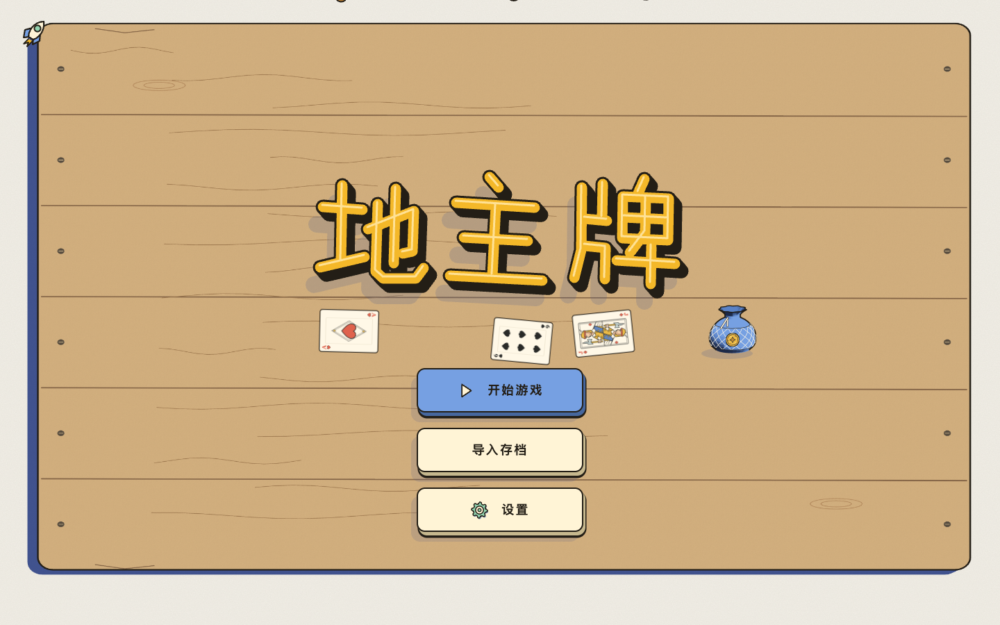
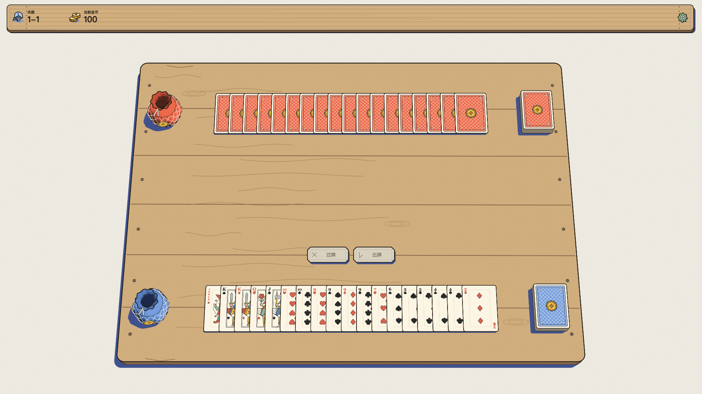
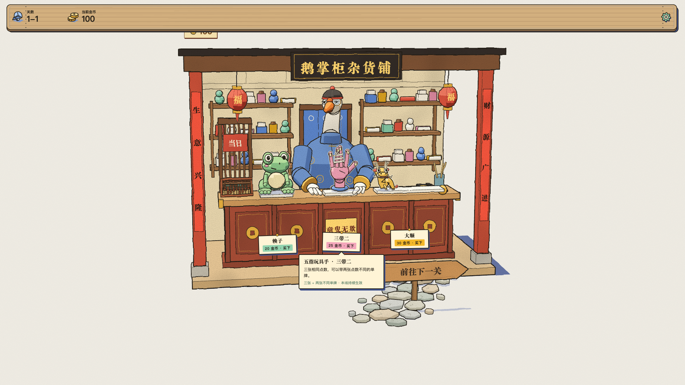
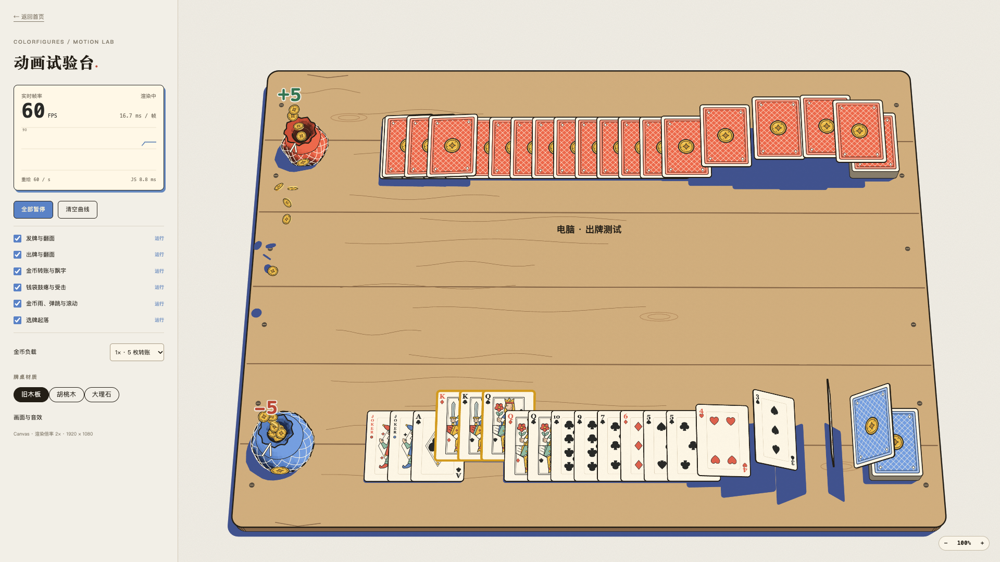

<h1 align="center">地主牌</h1>

DIzhuPai · 受小丑牌启发，以斗地主为原型的卡片肉鸽游戏，纯 Web 实现。

<a href="https://jessetzh.github.io/DiZhuPai/">在线试玩 →</a>

## 基本技术架构

- **前端**：原生 JavaScript（ES Modules）、HTML 与 CSS。
- **渲染**：Canvas 2D 绘制场景和动画，SVG 承载文字、键盘焦点与选牌交互区域。
- **模块**：`app/` 管理对局调度、导航与存档；`ui/` 管理页面和交互；`game/` 实现规则与状态；`engine/` 提供通用渲染能力；`cards/`、`coins/`、`shop/` 实现卡牌、金币与商店模型。
- **存储与构建**：浏览器 localStorage 保存进度，支持 JSON 导入导出；使用 esbuild 构建静态页面，通过 GitHub Pages / Nginx / Docker 部署。

## 杂货铺道具

道具在 `src/game/items.js` 定义（规则开关），玩具美术在 `src/assets/items/<id>.js`（模型/动画/图标/摆放），两处以 id 对应。每次进入杂货铺，鹅掌柜会从尚未拥有的道具里随机摆出三件。主界面的「道具图鉴」按钮可以随时查看全部道具（`ui/item-catalogue.js`），图标与文案复用同一份素材。

| 道具 | 玩具 | 效果 |
| --- | --- | --- |
| 赖子 | 好运青蛙 | 每小局随机一张手牌成为赖子，可代替任意普通点数 |
| 三带二 | 五指玩具手 | 三张相同点数，可以带两张点数不同的单牌 |
| 大顺 | 中国龙玩具 | 四张连续点数即可组成顺子，仍不能包含 2 和王 |
| 印章 | 橡皮印章 | 每小局开始时随机一张 Q 以下的牌点数 +1，被选中的牌翻转后飞到升点后的位置 |
| 天平 | 黄铜天平 | 可以用相同点数的牌压过对方的出牌 |
| 口罩 | 蓝布口罩 | 每小局第一次过牌不需要扣金币 |
| 小老鼠 | 机灵小鼠 | 每小局一次，把对方的出牌拿回自己的手牌 |

新增一个道具需要：`items.js` 登记（含 `rule` 字段）、`rules.js`/`state.js` 落实规则、`assets/items/<id>.js` 提供美术（`TOYS` 注册表会自动带进商店柜台、游戏桌面与顶栏图标），必要时在 `save.js` 补充存档校验。

## 游戏截图

<table>
  <tr>
    <td align="center"> 游戏首页</td>
    <td align="center"> 斗地主对局</td>
  </tr>
  <tr>
    <td align="center"> 关间玩具商店</td>
    <td align="center"> 性能测试页</td>
  </tr>
</table>

## 特别鸣谢

- 小丑牌：[Balatro](https://www.playbalatro.com/)
- 美术风格：[Colorfigures](https://april-zhu.com/colorfigures)
